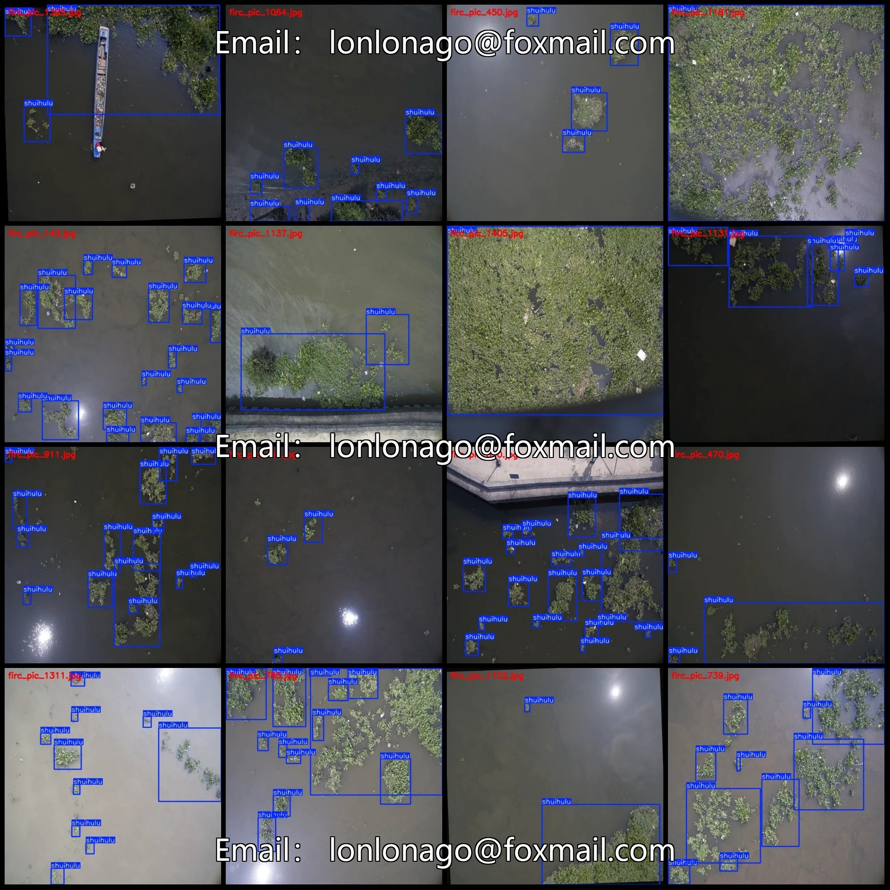
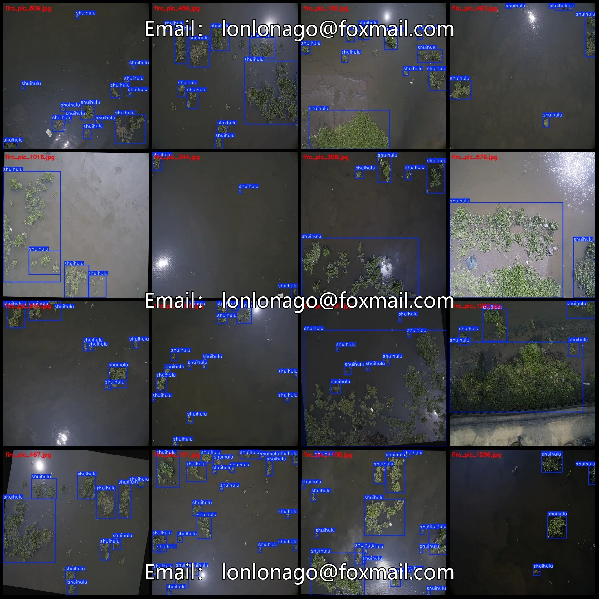
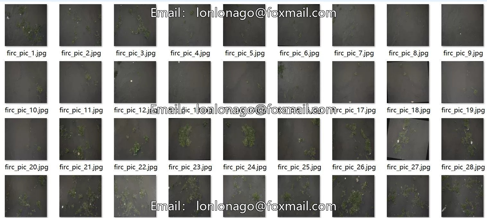
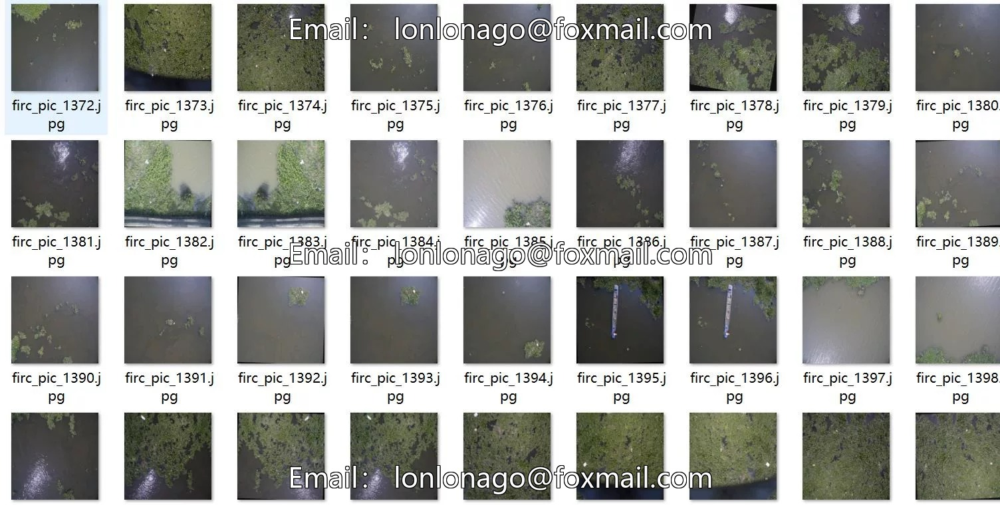
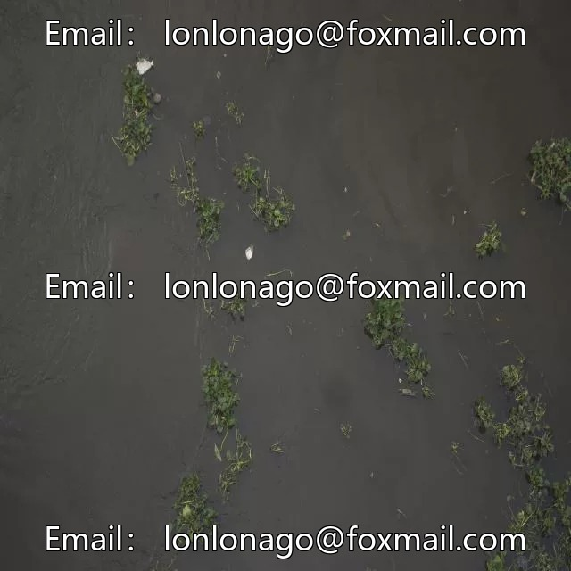
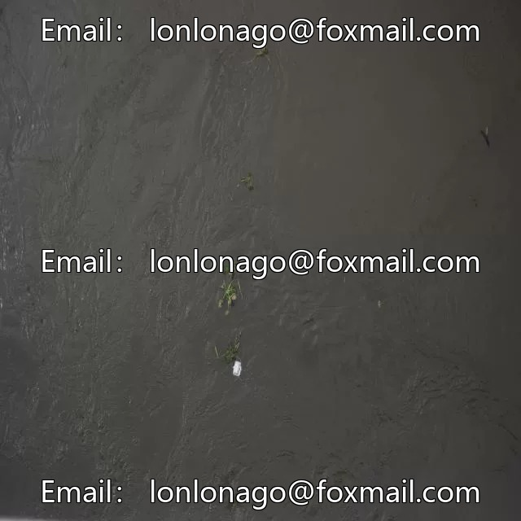

# Drone-view aerial photography dataset for water hyacinth detection in VOC+YOLO format, 1417 images

## Body

1. Dataset Description:
The dataset consists of 1417 images captured from drones, with a single category.

2. : Due to the dataset's reproducibility, please confirm that it meets your requirements before purchasing.

3. Dataset Format: The dataset is in Pascal VOC format combined with YOLO format (excluding the segmentation path as a txt file, only including jpg images and corresponding VOC format xml files and YOLO format txt files).

4. Number of Images (JPG Files): 1417

5. Number of Annotations (XML Files): 1417

6. Number of Annotations (TXT Files): 1417

7. Number of Annotation Categories: 1

8. Annotation Category Names: ["shuihulu"]

9. Boxes per Annotation Category:

Shuihulu Frame Count = 10845
Total Frame Count: 10845
Number of Images per Category
Shuihulu Image Count = 1417
Image Resolution: 640x640
Using LabelImg for Annotation
Annotation Rules: Draw a rectangle around the category.
Important Note: The dataset does not have separate training, validation, or test sets; you need to partition them yourself.
Special Remark: This dataset does not guarantee the accuracy of the trained models or weight files.

## Images

## Payment

Here is a pay link on Stripe ( https://buy.stripe.com/3cs8yP7sY87d0vu9AB ). Please contact me lonlonago@foxmail.com after funding $89, and I will send you a complete data files , thank you!

